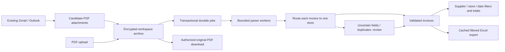

# Architecture

The workspace is the tenant boundary. Stores organize invoices within it. Every handler resolves membership from the session; record IDs, filter values and store IDs cannot select another workspace. Members share all stores in their workspace; owners govern connections and invitations. An email can contain invoices for several stores. Each attachment, and each clearly separable invoice inside a PDF bundle, is routed independently.

## Jobs and state

`processing -> ready | review | excluded | bundle`; review can become `approved` or `excluded`. Only ready/approved records assigned to a store enter validated totals and spreadsheets. Exact PDF hashes deduplicate per workspace. Publication checks supplier/invoice number per store under the write transaction, preventing simultaneous imports/reviews from publishing duplicates.

Document insert and job insert share a transaction. SQLite jobs have availability time, attempt count, a random lease token and a two-minute lease. Default worker concurrency is two (configurable 1–8). Expired leases can be reclaimed; only the current unexpired lease can finish a record. Infrastructure failures retry at most three times with delay, then become review records. Parser failures within its limits become actionable review records. Notification is just a wake-up hint; database jobs are the source of truth. Pending queue caps are 1,000 per workspace and 10,000 overall.

Bundle children receive their parent link in the initial insert, before any worker can claim them. A restart partway through splitting safely replays content-hash deduplication. Deleting a parent and unlinking children share a transaction. Retained original bundles can still contain deleted child invoices; deleting every active copy requires removing both records.

## Concurrent changes and idempotency

Each invoice has a monotonic revision. Browser review submits that revision; stale edits receive HTTP 409. Every storage update also checks the revision, including older API callers. Approval's optional Idempotency-Key identifies one user/workspace/invoice save intent. The payload hash, encrypted response and invoice mutation commit atomically. Replaying the same key/body returns the first result; reusing it with a different body returns 409. Receipts expire after 24 hours; deleting an invoice clears the workspace's retry receipts to remove retained invoice metadata. Uploads are independently content-hash idempotent. Other management endpoints do not yet have request-key replay.

## Queries, totals and exports

The browser loads 50 rows per page, fetches line items only when opening a record, debounces search, suppresses outdated list responses, and pauses background refresh when hidden or editing. Supplier/store/status/currency/date filters and deterministic sorting run server-side. Date ranges are inclusive and use invoice dates; missing dates do not match a date range. Totals include validated records only and keep currencies separate. Amount sorting groups by currency before comparing amounts.

Sensitive fields remain encrypted. Uncached filter/totals requests scan the workspace archive once and cache an encrypted result; bounded caches are invalidated by invoice changes. XLSX construction runs off the async runtime and outside the database lock. The version is checked before publishing an encrypted export cache entry, so a concurrent import cannot publish a stale cache. A download is a consistent snapshot at request time, not a live shared Google Sheet.

## Email and hosting

First capture uses a configurable 1–90 day lookback (default 30; the live-test launcher uses 1). Gmail is then tracked by its history position: the mailbox position is read before the first scan and saved as a cursor when the scan completes, so mail arriving during the scan is caught by the next check. A check asks Gmail whether anything was added since the cursor (one two-unit call, empty when the mailbox is quiet); only a hit triggers the filtered listing (`has:attachment filename:pdf`, so non-invoice mail is never fetched), which skips message IDs already processed and PDF hashes already stored. A listing that cannot finish in one check (30 pages of 100) saves its page token and resumes on the next. Gmail keeps history for about a week, so a 404 on the cursor means a full scan again; nothing is duplicated because processed IDs persist. A message is marked received only after supported attachments have been queued. Outlook uses an arrival-time filter with a two-hour overlap and the same processed-ID skipping; it has no cursor and a 60-page cap per check. Each mailbox runs on its own schedule (default 300 s, offsets spread by a hash of the mailbox, doubling backoff to one hour after consecutive failures), at most four checks at a time, with process-local locks preventing overlapping checks of one connector. Empty checks write no activity entry, and a failure writes one when it starts. HTTPS API host allowlists (derived from the configured provider roots, which tests point at a fake) and disabled redirects protect token destinations. GET retries are bounded; long Retry-After delays persist by access-token hash. Connecting a real mailbox to the shared sample workspace is rejected.

SQLite WAL and private local files remain a single-host design. PostgreSQL/shared private object storage, push notifications (Gmail Pub/Sub, Graph webhooks) with a slow safety poll, Outlook delta tracking, provider event adapters, verified customer identities and production worker/key isolation are the next scaling work. See RESEARCH.md and GMAIL_TESTING.md for evidence, limitations and the next test sequence.
